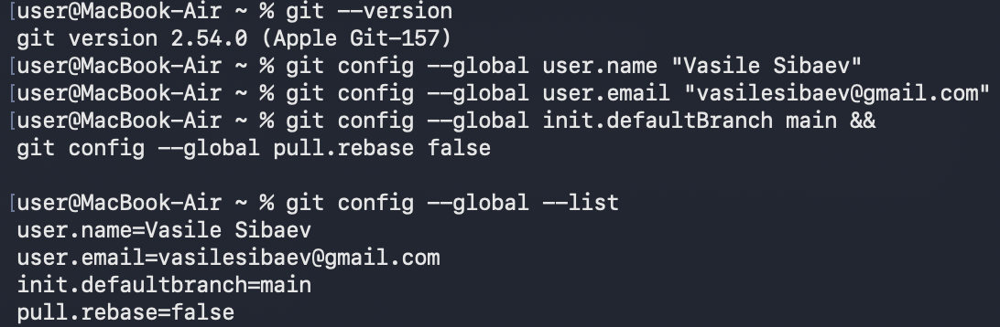
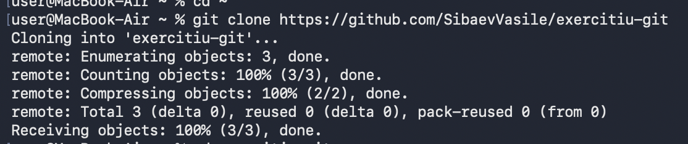
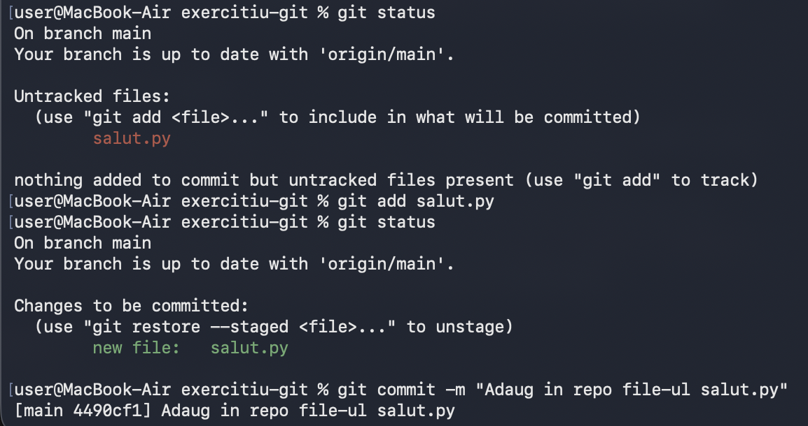
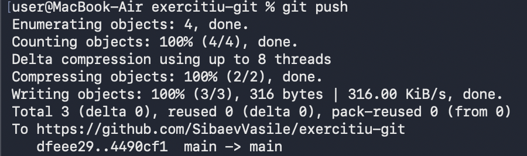
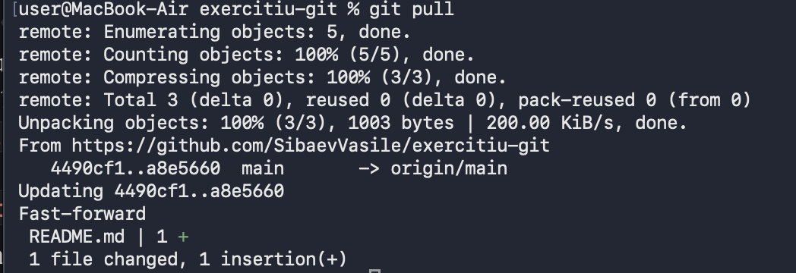
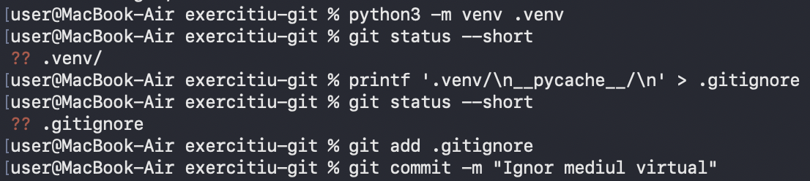
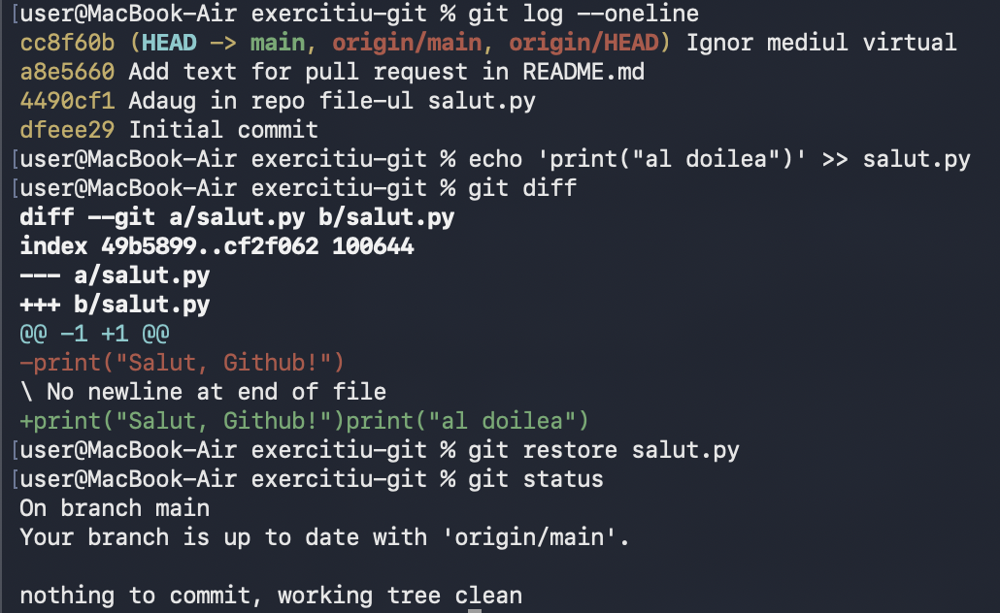
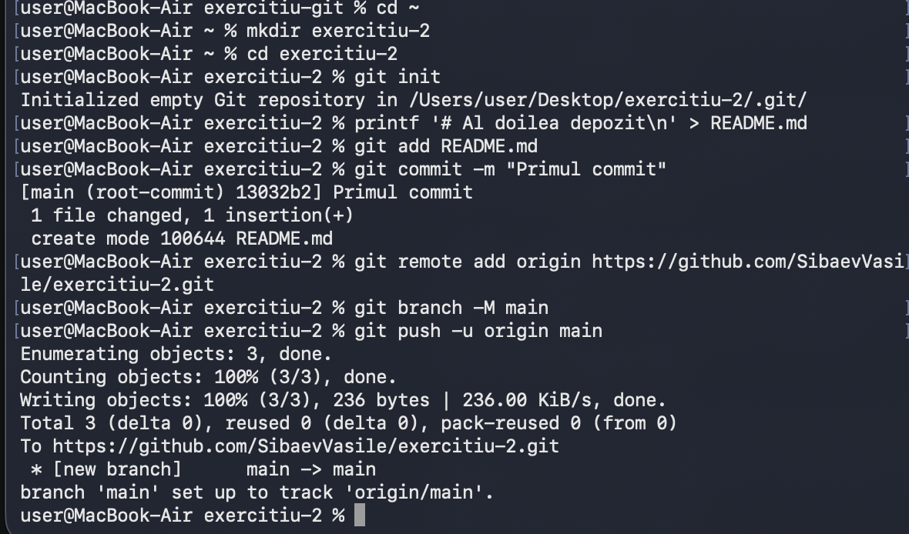
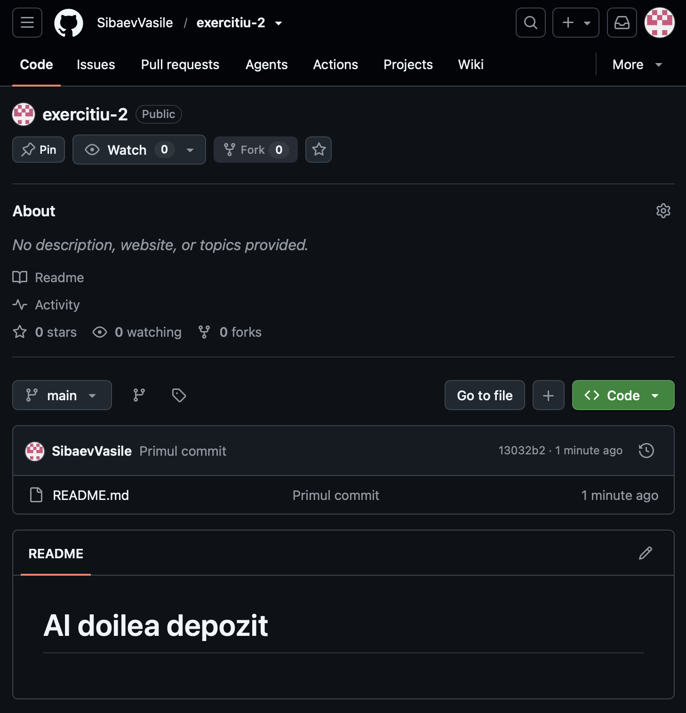
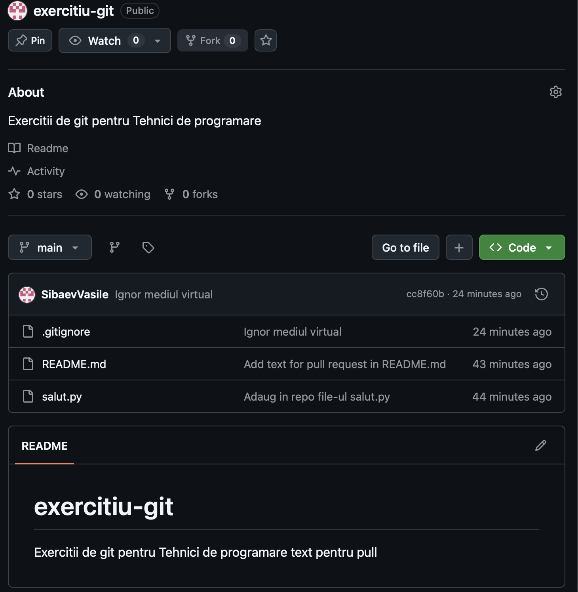

# Laboratorul 6. GitHub, pas cu pas

**Nume și prenume:** Vasile Sibaev
**Grupa:** SI-265
**Username GitHub:** SibaevVasile

## Linkuri

- Depozit exercițiu 1 (public): https://github.com/SibaevVasile/exercitiu-git
- Depozit exercițiu 2 (public): https://github.com/SibaevVasile/exercitiu-2
- Depozit privat al disciplinei: https://github.com/SibaevVasile/TP_Sibaev_Vasile_SI-265

## Ce am exersat la fiecare pas

- **A1. Contul GitHub.** Mi-am folosit contul `SibaevVasile`, cu un nume de utilizator simplu și profesional, pentru că apare în toate linkurile mele.
- **A2. Git pe calculator.** Am verificat cu `git --version` că git este instalat și mi-am setat identitatea (`user.name`, `user.email`, `init.defaultBranch main`, `pull.rebase false`), cu aceeași adresă de e-mail ca în contul GitHub, ca să fie legate commit-urile de contul meu.

- **A3. Primul depozit pe GitHub.** Am creat `exercitiu-git`, public, cu fișier README, direct din browser.
- **A4. `git clone`.** Am descărcat depozitul pe calculator și am lucrat de acolo în folderul `exercitiu-git`.

- **A5. `status`, `add`, `commit`.** Am creat `salut.py` și am văzut că git îl raportează ca „untracked”, apoi l-am pus în „fotografie” cu `git add` și am salvat-o cu `git commit -m`.

- **A6. `git push`.** Am trimis commit-ul pe GitHub, m-am autentificat prima dată și am verificat în browser că apare `salut.py`.

- **A7. `git pull`.** Am editat `README.md` în browser, apoi am adus schimbarea pe calculator cu `git pull` (un „fast-forward”).

- **A8. `.gitignore`.** Am creat mediul virtual `.venv`, am văzut că git îl raportează și am adăugat regulile `.venv/` și `__pycache__/`, ca să nu ajungă pe GitHub fișiere inutile.

- **A9. `git log` și `git diff`.** Am citit istoria cu `git log --oneline`, am văzut o schimbare înainte de commit cu `git diff` și am anulat-o cu `git restore`.

- **A10. Al doilea depozit, pornit local.** Am creat `exercitiu-2` cu `git init`, am făcut primul commit, am legat depozitul de GitHub cu `git remote add origin` și l-am trimis cu `git push -u origin main`.

- **A11. Verificare** 
Primul repo 

Al doilea 

## Sursele 

Nu au fost necesare fiindcă sunt deja familiar cu git și github-ul având practică în studiile precedente.
